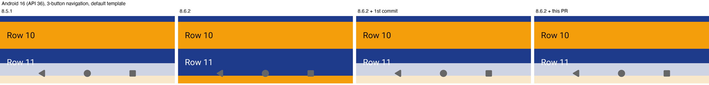
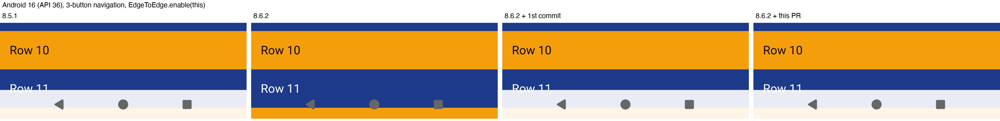
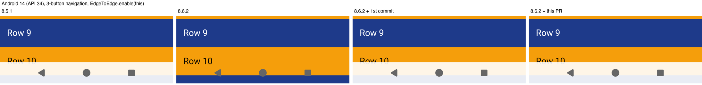
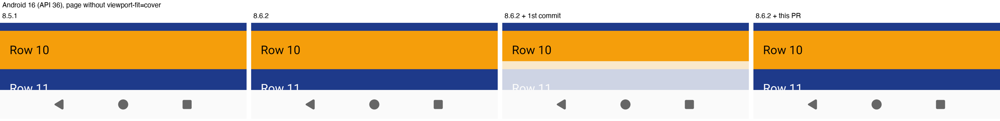
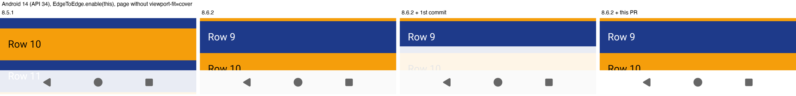
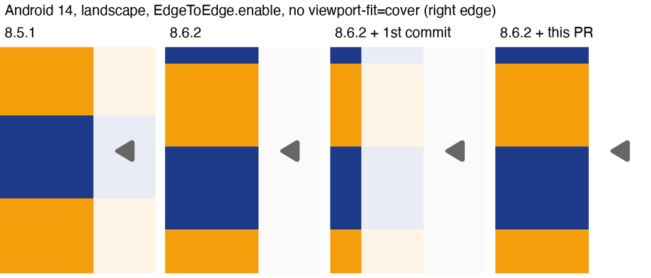

# Capacitor SystemBars: 3-button navigation bar scrim missing since 8.5.2

This is a minimal repro for an Android regression in `@capacitor/android` 8.5.2 and later; 8.5.1 is fine. Issue: ionic-team/capacitor#8724, fix: ionic-team/capacitor#8725.

With 3-button navigation, the navigation bar no longer gets its translucent contrast scrim, and web content shows unprotected behind the back, home and recents buttons. On windows that are not edge-to-edge (Android 14 and older without `EdgeToEdge.enable`), the navigation bar also loses its normal opaque background.

The app is the default `npx cap add android` template, except for `www/index.html`:
- alternating dark and light rows show whether there is a scrim behind the navigation buttons;
- a box at the top prints `env(safe-area-inset-*)`, `--safe-area-inset-*` and `window.innerHeight`, to check that the fix leaves insets unchanged;
- **cover** / **no cover** switch the page between `viewport-fit=cover` (SystemBars passes the insets through to the WebView) and no `cover` (SystemBars pads the native view instead). The choice is kept in `localStorage`;
- the **keyboard** field opens the soft keyboard, where SystemBars pads the native view by the keyboard height.

## Run it

You need an emulator or device with 3-button navigation. Emulators default to gesture navigation; to switch, run `adb shell cmd overlay enable com.android.internal.systemui.navbar.threebutton` and `adb shell cmd overlay disable com.android.internal.systemui.navbar.gestural`.

```sh
npm install
npx cap sync android
npx cap run android          # 8.6.2, no scrim

./apply-fix.sh               # applies systembars-scrim-fix.patch (the change from #8725) to node_modules/@capacitor/android
npx cap sync android
npx cap run android          # 8.6.2 + fix, scrim is back
```

To compare with 8.5.1, run `npm i -E @capacitor/android@8.5.1 && npx cap sync android && npx cap run android`.

To test with `EdgeToEdge.enable(this)`, which the SystemBars docs recommend on Android 14 and older, add it to `MainActivity.onCreate` after `super.onCreate(savedInstanceState)`.

## Results

Tested on Android 16 (API 36, WebView 156) and Android 14 (API 34, WebView 157) emulators with 3-button navigation, with and without `EdgeToEdge.enable`, in all three page modes. Android 14 was also tested in landscape, where the navigation bar is on the side.

| Setup | 8.5.1 | 8.6.2 | 8.6.2 + fix |
|---|---|---|---|
| API 36, default template | scrim | **no scrim** | scrim |
| API 36, `EdgeToEdge.enable` | scrim | **no scrim** | scrim |
| API 34, `EdgeToEdge.enable` | scrim | **no scrim** | scrim |
| API 34, default template (not edge-to-edge) | black navigation bar | **light grey bar** | black navigation bar |

- **API 36:** with the fix, every case (cover, no cover, keyboard open; with and without `EdgeToEdge.enable`) is pixel-identical to 8.5.1 below the status bar, apart from the blinking text cursor.
- **API 34:** the navigation bar matches 8.5.1 in every case, and the WebView keeps the size and position it has on 8.6.2.
- The page sees the same `env(safe-area-inset-*)`, `--safe-area-inset-*` and `innerHeight` with the fix as on 8.6.2.

"1st commit" in the screenshots is the first commit of #8725 on its own. It restored the scrim, but SystemBars still padded the DecorView, which holds the system bar background views, so the scrim ended up inside the content whenever that padding is not 0. The second commit pads the WebView's parent instead.











## Cause

Since 8.5.2 (e37d9c6), `SystemBars.initWindowInsetsListener()` registers its `OnApplyWindowInsetsListener` on `getWindow().getDecorView()`. 8.5.1 registered it on the WebView's parent.

A listener is called *instead of* the view's own `onApplyWindowInsets`. For the DecorView, that method lays out the system bar backgrounds, including the navigation bar contrast scrim. The Android reference for `View.OnApplyWindowInsetsListener` says: "The listener may optionally call the parameter View's `onApplyWindowInsets` method to apply the View's normal behavior as part of its own."

## Fix

`systembars-scrim-fix.patch` (the full change from #8725):
1. calls the DecorView's own `onApplyWindowInsets` first and continues with the insets it returns;
2. applies SystemBars' padding to the WebView's parent instead of the DecorView, so the system bar backgrounds stay at the screen edges.
